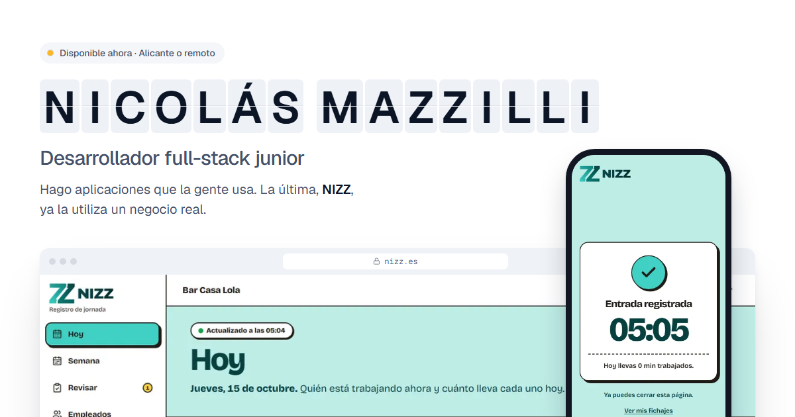

# Portfolio de Nicolás Mazzilli

Web personal de Nicolás Mazzilli, desarrollador full-stack junior en Alicante. Publicada en **[nicolasmazzilli.vercel.app](https://nicolasmazzilli.vercel.app)**, en español (`/`) e inglés (`/en/`).

El diseño parte de un panel de salidas de una estación: el nombre aparece en fichas que giran, los proyectos son salidas con su hora, estado y vía, y la trayectoria es una línea de Cercanías que termina en «Tu empresa».



## Stack

- **Astro 6**: páginas estáticas, i18n con rutas reales, fuentes autoalojadas e imágenes optimizadas (`astro:assets`).
- **Tailwind CSS 4**: tokens de color, radios, sombras y tiempos en `@theme`.
- **GSAP + ScrollTrigger**: solo para la secuencia de NIZZ en escritorio, descargado cuando está a punto de entrar en pantalla. Las fichas del nombre y la línea usan la Web Animations API.
- **Vercel**: hosting estático y una única función de servidor para el formulario de contacto, que envía el mensaje con **Resend**.
- **Playwright + axe**: pruebas de extremo a extremo, capturas y accesibilidad.

## Cómo ejecutarlo

Requisitos: Node.js 22.12 o superior.

```bash
npm install
npm run dev        # servidor de desarrollo en http://localhost:4321
npm run build      # compilación de producción en dist/
npm run check      # comprobación de tipos de Astro
npm test           # pruebas de Playwright sobre la compilación (ejecutar antes npm run build)
```

### Formulario de contacto

El formulario funciona sin JS (envío normal) y con JS (validación en el navegador y envío por `fetch`). La función `src/pages/api/contact.ts` valida de nuevo en el servidor, descarta los envíos con el campo trampa relleno o hechos en menos de 3 segundos, limita a 5 mensajes cada 10 minutos por IP y manda el correo con `reply_to` al email del visitante.

Variables de entorno (en Vercel y, en local, en un `.env` que no se versiona):

| Variable | Para qué |
|---|---|
| `RESEND_API_KEY` | Clave de Resend con permiso solo de envío. |
| `CONTACT_TO` | Email que recibe los mensajes. |
| `CONTACT_FROM` | Remitente. Opcional; por defecto `Portfolio <onboarding@resend.dev>`, que solo entrega al email de la cuenta de Resend. |

Sin `RESEND_API_KEY` o `CONTACT_TO`, el formulario responde con error y ofrece escribir directamente al email.

## Estructura

```
src/
├── i18n/            # Textos en español (es.ts) e inglés (en.ts)
├── data/            # Datos del sitio y de los proyectos
├── assets/shots/    # Capturas de los proyectos (las de NIZZ, con datos ficticios)
├── layouts/         # HTML base: SEO, Open Graph, hreflang, JSON-LD y fuentes
├── components/      # Cabecera, hero, NIZZ, panel de salidas, trayectoria, contacto…
├── scripts/         # Movimiento, formulario y aviso de copiado
├── lib/             # Validación del formulario, común al navegador y al servidor
├── styles/          # Tokens y estilos base
└── pages/           # /, /en/, 404 y la función /api/contact
tests/               # Pruebas de Playwright y servidor estático para ejecutarlas
docs/                # Revisiones (Web Interface Guidelines)
```

`PRODUCT.md` recoge el propósito y el público de la web; `DESIGN.md`, el sistema visual.

## Calidad

- Lighthouse ≥ 95 en rendimiento, accesibilidad, buenas prácticas y SEO, en móvil y escritorio.
- Sin violaciones de axe (WCAG 2.2 AA), contenido visible sin JS y respeto a `prefers-reduced-motion`.
- Sin scroll horizontal de 360 a 1440 px.
